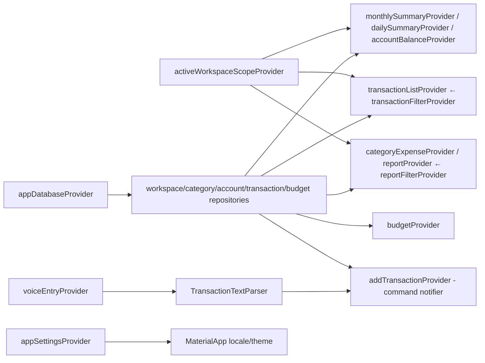
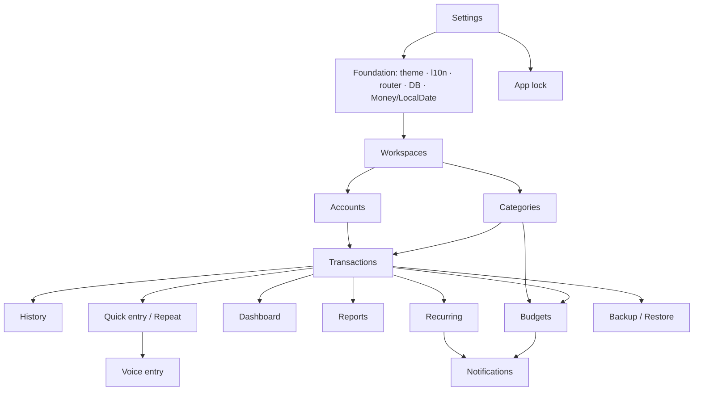
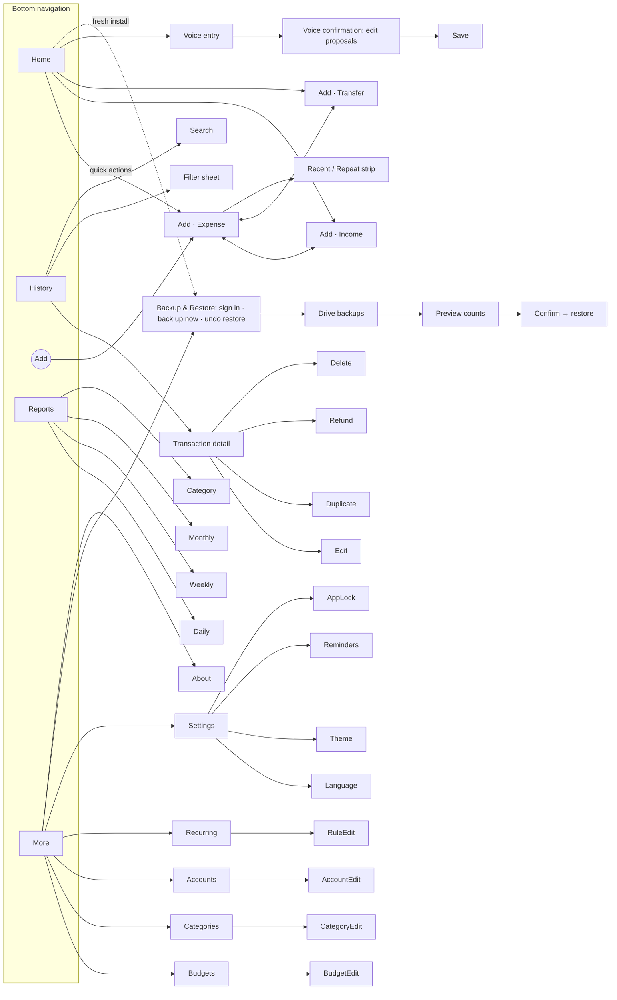

# Hisab — Analysis & Architecture (PRD §30 Step A)

Status: **Approved 2026-11-21** (§10 decisions accepted as proposed) · Phases 1–4 implemented · Targets: Flutter 3.47.9 / Dart 3.13.7, Android only

This document covers the six Step A deliverables: requirement breakdown, architecture proposal,
database ER diagram, feature dependency map, screen navigation map and implementation task list.
Section 2 lists the accounting and data decisions the PRD leaves open; these are the parts that most
need review, because changing them after real data exists means a migration.

---

## 1. Requirement Breakdown

| # | Module | MVP requirements (PRD ref) | Phase |
|---|---|---|---|
| R1 | Foundation | Feature-based clean architecture, theme (light/dark, PRD palette), bn/en localization, GoRouter 5-tab nav, Drift DB + migrations (§2, §4, §18–22) | 1 |
| R2 | Workspaces | Personal + Family isolated at data level; Combined read-only scope; switcher (§3) | 1 |
| R3 | Categories | Seeded defaults with subcategories (§7.1), CRUD, icon/color, safe delete/reassign, fallback "Others" (§7.2) | 1 (seed) / 2 (CRUD UI) |
| R4 | Accounts | Cash/Bank/bKash/Nagad/Other, opening balance, derived current balance, active flag, per-workspace (§13) | 1 (seed) / 2 |
| R5 | Transactions | Income, expense, transfer (incl. cross-workspace), refund workflow; CRUD, duplicate/repeat, validation (§6, §23) | 2 |
| R6 | Quick entry | Amount-first form, icon category grid, last-used account, today default, recent/repeat (§8) | 2 |
| R7 | History | Date-grouped list, filters (scope/type/category/subcategory/account/date range), search, pagination (§10, §24) | 2 |
| R8 | Dashboard | Balance, month income/expense, remaining budget, today's spend, daily chart, quick actions, recent, budget summary (§5) | 3 |
| R9 | Reports | Daily / weekly / monthly / category; Personal/Family/Combined; fl_chart charts; previous-month comparison (§11) | 3 |
| R10 | Budgets | Monthly per workspace+category, utilization, thresholds (default 80/100/>100) with notifications (§12) | 4 |
| R11 | Voice entry | speech_to_text bn/en, rule-based parser behind an interface, multi-item proposals, mandatory confirmation (§9) | 4 |
| R12 | Recurring | Daily/weekly/monthly/custom rules, pause/resume, idempotent generation (§14) | 4 |
| R13 | Notifications | Daily reminder (configurable), budget alerts, recurring upcoming, monthly summary (§15) | 4 |
| R14 | Backup/restore | Manual backup to user-chosen location, validated restore, corruption protection (§16) | 5 |
| R15 | Security | Optional PIN + biometric lock; no network use (§17) | 5 |
| R16 | Quality | Unit, DB, widget, integration tests; release APK/AAB (§25, §26) | every phase / 5 |

Out of scope (§28): login, cloud sync, SMS/bank parsing, AI APIs, iOS/web. The schema still includes
the columns that sync will need later (see D2 and D7).

---

## 2. Key Decisions (review these first)

### D1 — Money is an integer number of paisa
- Every monetary column is `INTEGER` (`*_paisa`). In the domain it is a zero-cost Dart
  `extension type Money(int paisa)` with `+`, `-`, comparisons and formatting. No `double` is ever
  used for amounts.
- Amount input is parsed from a string into paisa (`"100.50"` → `10050`). The parser accepts Bangla
  digits (০–৯) and rejects more than two decimal places.
- Display: `৳1,500`, using South-Asian (lakh) grouping for large values (`৳1,00,000`). In Bangla
  mode the digits are Bangla (`৳১,৫০০`), with a setting to switch this off.

### D2 — IDs are UUIDv7 text
- Every primary key is a `TEXT` UUIDv7: it sorts by time and can be created offline without
  collisions. That is the main requirement for future multi-device Family sync.
- Every syncable table has `created_at`, `updated_at` and `deleted_at` (a tombstone). Sync can be
  added later without changing the domain model (§16).

### D3 — Transaction date = calendar date + time
- `local_date INTEGER` stores the date as `yyyymmdd`, the calendar date the user chose.
  `occurred_at INTEGER` stores the epoch milliseconds of the chosen date and time.
- All reports, grouping and month boundaries use `local_date`, so §23 rules 12 and 13 hold. Example:
  November = `local_date BETWEEN 20261101 AND 20261130`. The result does not depend on the
  timezone, needs no SQLite `localtime` call, and can be indexed.
- `created_at` and `updated_at` are audit fields only. Reports never use them.

### D4 — A transfer is stored as two linked rows
At the database level, `transactions.type` takes one of five values:

| DB type | Domain meaning | Balance effect | Counted in income/expense totals? |
|---|---|---|---|
| `income` | Income | +amount | Income |
| `expense` | Expense | −amount | Expense |
| `refund` | Refund of an expense (D5) | +amount | Reduces expense |
| `transfer_out` | Transfer, source leg | −amount | **No** |
| `transfer_in` | Transfer, destination leg | +amount | **No** |

- A transfer is written as **two rows in one DB transaction**, linked by `transfer_group_id`. Each
  row belongs to the workspace of its own account, and `counter_account_id` points at the other
  account. Edits and deletes always act on both rows together.
- The domain still has exactly three types, `income | expense | transfer`, as §6.1 requires. A
  `Transfer` entity hides the two rows from the rest of the app.
- Why two rows: every row has exactly one workspace and one account from that workspace (§23
  rule 11). The account balance is one simple SQL sum. Workspace filtering keeps working for
  cross-workspace transfers.

**Cross-workspace transfers (Personal → Family), §6.4:**
- Personal records a `transfer_out` and Family records a `transfer_in`. Neither row counts as income
  or expense in any report: Personal, Family or Combined.
- The Personal account balance goes down and the Family account balance goes up. In Combined the two
  rows cancel out, so nothing is counted twice.
- The money counts as an expense only when Family actually spends it. Workspace reports show
  "Transferred in" and "Transferred out" lines separately from income and expense, so the numbers
  are easy to explain.

### D5 — Refunds and corrections
- **Refund:** created from an existing expense with the "Refund" action. It is a `refund` row with
  `refund_of_id` pointing at the original expense. It copies the original category, may be partial,
  and the total refunded can never exceed the original amount.
- A refund **adds to the account balance and lowers net expense** for that category and month (the
  month of the refund's own `local_date`). It is **never income**, so §23 rule 7 holds.
- Budgets use net expense (expense − refunds). This is the "specific adjustment rule" that §23
  rule 10 asks for.
- **Correction:** this is simply editing the transaction. `updated_at` changes and every summary is
  recomputed, because all reports are live queries (D6).

### D6 — Balances and summaries are computed, never stored
- Account balance = `opening_balance_paisa + Σ(income, refund, transfer_in) − Σ(expense, transfer_out)`
  over rows that are not deleted. There is no `current_balance` column, so a stored balance can
  never drift from the real numbers. This satisfies §13 and §23 rules 8 and 9.
- Aggregation runs in SQL (`SUM … GROUP BY`) through Drift `watch()` streams. Any insert, update or
  delete refreshes the dashboard and reports automatically, and no provider needs manual
  invalidation (§21).

### D7 — Deletion is soft (financial records are never lost)
- Deleting a transaction asks for confirmation, then sets `deleted_at`. An "Undo" snackbar restores
  it. Every query filters on `deleted_at IS NULL`.
- The tombstones double as sync tombstones later (D2).
- Categories and accounts that are referenced by transactions cannot be deleted. They can be
  **archived** (`is_active = 0`), or, for categories only, **reassigned** to another category in one
  DB transaction and then archived.

### D8 — Categories are global by default, with translated system names
- Default categories are seeded with `workspace_id = NULL`, so Personal and Family share them. Users
  can create categories that are global or limited to one workspace.
- Seeded rows carry a `system_key` (for example `grocery.fish`). The UI shows the translated name
  from the ARB files, so switching language changes the category names too. User-created categories
  show their stored `name`.
- There are two levels: a category and its subcategories (`parent_id`). A transaction stores both
  `category_id` (top level) and an optional `subcategory_id`. Validation checks that
  `subcategory.parent_id == category_id` and that the category type matches the transaction type.
- Fallback categories: `others` for expenses and `income.other` for income. Both are protected and
  cannot be deleted.

### D9 — Workspace scope
- `WorkspaceScope = personal | family | combined`. **Combined is read-only.** Entry forms always ask
  for a real workspace, defaulting to the last one used.
- Every repository query takes a `WorkspaceScope` and turns it into `workspace_id IN (...)`. No query
  can run without a workspace filter, which enforces the data-level separation that §3.3 requires.

### D10 — Settings storage
- Settings that should be backed up (language, theme, digit style, reminder time, budget thresholds)
  live in the `app_settings` table, so a backup is one self-contained file.
- `shared_preferences` holds only per-device conveniences: last-used account and workspace, and the
  last tab.
- `flutter_secure_storage` holds the hash of the app PIN.

### D11 — Recurring transactions cannot duplicate
- `recurring_executions` has a UNIQUE constraint on `(rule_id, occurrence_date)`. The generator runs
  at app start and resume, inside a DB transaction. It catches up every due occurrence up to today
  and records each execution in the same transaction as the transaction row it creates.
- Because the uniqueness is enforced by the database, restarts or the generator running twice cannot
  create duplicates (§14).

### D12 — Voice parsing sits behind an interface
- `abstract interface class TransactionTextParser { List<ParsedProposal> parse(String text, ParseContext ctx); }`
- The MVP implementation, `RuleBasedBnEnParser`, handles:
  - Bangla and English digits and number words (৩৫০, তিনশো পঞ্চাশ, দেড় হাজার, 1.5k)
  - splitting one sentence into items on আর / এবং / and / `,`
  - dates such as আজ / আজকে / গতকাল / today / yesterday
  - a keyword dictionary that maps words to category and subcategory (মাছ → grocery.fish,
    অফিস যাওয়া → transport.office)
  - income cues such as বেতন / salary
- Every proposal has a confidence value. **Nothing is saved without the confirmation screen.**
- A future AI parser only needs to implement the same interface.

### D13 — Backup format
- The backup is a `.hisab` file: gzip-compressed JSON containing a header (`format_version`,
  `schema_version`, `app_version`, `created_at`, per-table row counts, and a SHA-256 checksum of the
  payload) and the rows of every table.
- Before restoring, the app checks the checksum and schema version, then validates every row and
  foreign key in memory. It writes an automatic **safety backup** of the current data, then replaces
  all data **in one DB transaction**. Any failure rolls back, so a corrupt file can never leave the
  data half-restored.
- ~~Backups are saved to a location the user picks through the Android Storage Access Framework, or
  shared through the share sheet.~~ Superseded by **D22**: backups go to the owner's Google Drive.

### D14 — Single workspace; Family removed (2026-11-22, owner request)
- The owner does not need Personal / Family separation, so the Family workspace is removed for
  good. This supersedes D9: there is one **Personal** workspace and no scope switching.
- Removed: the switcher, `WorkspaceScope` and Combined, the Personal/Family split card, every
  workspace picker and label, the cross-workspace transfer note, and the related strings.
  `WorkspaceType` has only `personal`, and the seeder creates only Personal.
- **Schema v2** (`removeFamilyWorkspace`) deletes the Family workspace and everything in it:
  accounts, its own categories, budgets, recurring rules and executions, and transactions. A
  transfer between Personal and Family is deleted as a whole (both legs), since half a transfer
  would be an unexplained balance change. No table changes. The `CHECK` on `workspaces.type` still
  lists `'family'`, because changing it needs a table rebuild.
- The `workspace_id` columns and filters stay. Every query runs with the single workspace's ID,
  which keeps the data layer unchanged and leaves room for a future sync design.

### D15 — Month start day / salary cycle (2026-11-22, owner request)
- Settings → **Month starts on** sets `month_start_day`, 1–28, default 1. With 1 every "month"
  is the calendar month, so the default behaves exactly as before. The limit is 28 so every
  month has the start day and February needs no clamping.
- `MonthCycle` (`core/utils/month_cycle.dart`) is the only place that cuts months. A cycle is
  identified by its **start month**: with 20, the "November" cycle is 20 Nov – 19 Dec. A date
  before the start day belongs to the previous month's cycle.
- It is used by the dashboard month summary, the Reports month view, previous-month comparison,
  the 6-month trend (SQL groups by `MonthCycle.sqlKey`), Budgets (spent and rollover) and the
  monthly summary notification, which fires on the first day of the next cycle.
- **No schema change.** `budgets.year/month` is read as the cycle key. Changing the start day
  keeps every budget under the same key and only recomputes what was spent (D6), so no data is
  lost.
- Labels: a calendar month shows "November 2026". Other cycles show their range, such as
  "20 Nov – 19 Dec". Trend bars show the start month's short name.

### D16 — Loans: money lent to or borrowed from people (2026-11-23, owner request, schema v3)
**Problem:** someone repays money you lent them. Recording it as Income would inflate income
reports and savings, since it is your own money coming back, and it would not say who still owes
what.

- A loan step is **not income and not expense**. It changes an account balance (like a transfer,
  D4) but is invisible to income/expense reports, budgets and recurring rules.
- Two new tables, `persons` and `loan_entries`. **`transactions` is not touched**, because changing
  its CHECK constraint would need a full table rebuild on real data. Schema v3 only adds tables
  and indexes (`migrations/add_loans.dart`, safe to re-run).
- `loan_entries.kind`:

| kind | meaning | account balance | open amount |
|---|---|---|---|
| `lent` | I gave money | −amount | they owe me **+** |
| `repaid_to_me` | they paid me back | +amount | they owe me **−** |
| `borrowed` | I took money | +amount | I owe **+** |
| `repaid_by_me` | I paid back | −amount | I owe **−** |

- `account_id` is nullable for `lent` / `borrowed` only: an **old loan** from before the app (or
  never recorded). It changes no balance. A repayment always has an account (CHECK + repository).
- Per-person open amounts and totals are computed from the entries, never stored (D6):
  `owedToMe = Σlent − Σrepaid_to_me`, `iOwe = Σborrowed − Σrepaid_by_me`.
- `AccountsDao` balance = opening + Σ transactions + Σ loan entries (`LoansDao.signedAmountSql` is
  the one definition of the loan sign). Reports and budgets read only `transactions`, so they are
  unchanged.
- **One rule keeps it honest:** a repayment can never exceed what is open. The repository checks
  it **after every create, edit and delete inside the DB transaction** (`_assertConsistent`), so
  deleting a loan under an existing repayment, or lowering a loan below what was repaid, is also
  refused (`ConflictException(LoanError.exceedsOutstanding)`). Partial repayments are allowed.
- People are found by name (case-insensitive) when an entry is added, so one name is one person.
  A person with live entries cannot be deleted; an account used by a live loan entry cannot be
  deleted (`usageCount` includes loan entries).
- UI: More → "ধার ও পাওনা" (`/more/loans`, `/more/loans/:id`), entry bottom sheet with a
  "পুরনো ধার" switch, and a "পাবো / দেবো" card on Home shown only while something is open.
- Phase 5 backup must include `persons` and `loan_entries`.

### D17 — Savings: a savings account type and "send what is left" (2026-11-24, owner request, schema v4)
**Problem:** the owner wants to set aside whatever remains after expenses, and see it apart from
money they can spend. "Savings" on Home was only income − expense, a number that never left an
account.

- Saving is **a transfer** (D4) into an account of the new type `savings`. It is not income and not
  expense, so reports, budgets and recurring rules are unchanged. No new table, no stored total (D6).
- `accounts.type` CHECK now allows `'savings'`. SQLite cannot alter a CHECK, so schema v4
  (`migrations/add_savings_account_type.dart`) rebuilds `accounts` through drift's `alterTable`:
  same rows, same columns, indexes re-created, skipped when the table already allows `'savings'`.
  Tested on a v3 file with foreign keys on: rows, balances, transactions and loan links survive.
- Home (`features/accounts/domain/savings.dart` holds the rules):
  - Balance card: "এর মধ্যে সঞ্চয় ৳X" (savings part of the total; the total still includes it).
  - Savings card: "এই মাসে সঞ্চয়ে সরানো" = Σ transfer-in − Σ transfer-out on savings accounts inside the
    current `MonthCycle` range (D15) (`AccountsDao.watchSavingsMoved`). With no savings account the
    card only suggests creating one.
  - Button "৳R সঞ্চয়ে পাঠান" opens the transfer form prefilled
    (`/add?type=transfer&to=&from=&amount=`). `R = min(net − moved, spendable)`, never negative.
    From = the active non-savings account holding the most; To = the first active savings account.
    The owner can change everything before saving.
- The Home tile `monthNet` was renamed from "এই মাসের সঞ্চয়" to "এই মাসে বাকি", so "savings" now
  means only money actually moved. The tile keeps that label (owner's choice) but its amount is
  income − expense − moved (`Savings.leftThisMonth`), the same amount the "send" button offers, so
  the two never disagree. An overspent month shows its deficit unchanged. Reports
  still show plain income − expense.
- Not built: savings goals / progress bars / interest.
- Phase 5 backup needs nothing new (no table), but a restored file must be at schema v4.

---

### D18 — Recurring transactions removed (2026-11-24, owner request, no schema change)

- The owner did not want the feature. It also had a trap: deleting a recurring *rule* kept the
  transactions it had already recorded, so a deleted rule still counted in the balance.
- Removed: the "Recurring transactions" screen/form/routes, the "Make recurring" button, the
  generator in `AppMaintenance`, `RecurringDao`, the "upcoming recurring" notification and its
  setting, and the l10n strings. **D11 no longer applies.**
- **Kept on purpose:** the `recurring_rules` / `recurring_executions` tables, the
  `transactions.recurring_rule_id` column and `source = 'recurring'` stay in the schema (still v4).
  Dropping them needs a rebuild of `transactions` (FK + CHECK) on a phone holding real data, for no
  gain. Nothing reads or writes them. Old transactions with source `recurring` are ordinary
  transactions now and can be deleted from History/detail.
- `NoticeIds.legacyRecurring*` slots are only cancelled, so a reminder scheduled by an older
  build cannot fire.

### D19 — Home leads with "left this month", not the total balance (2026-11-26, owner request)

- Owner wants the month's remaining money highlighted on opening the app so it reins in spending.
  The total balance (savings and earlier months included) made the pocket look fuller than it is.
- The top card is now **এই মাসে বাকি** = `Savings.leftThisMonth` (income − expense − moved to
  savings, D17). Total balance moved to the small tile where "left" was, in a neutral colour.
  Overspent: red number, red edge, "spent ৳X more than earned".
- Tried and rejected by the owner on a device: an income bar (spent/saved/rest) with
  "today + N days · up to ৳X a day" under the figure. Only the plain swap was kept.
- The Savings card lost its "send ৳X to savings" button (owner request): mid-month the money
  left is still needed for spending. It only shows "moved to savings this month" (or the setup
  hint). `Savings.remaining/source/spendable/total` went with it; save via Add → Transfer.
- "of which savings ৳X" under the total was dropped (the small tile has no room); savings are on
  the Savings card and in Accounts.

### D20 — Animations (2026-11-27, owner request)

- Picked by the owner from a demo canvas ("Hisab: animation examples"): for the tab bar, the
  gliding pill (not fade-through or slide); in the app, count-up figures, staggered cards, the
  save tick + new row, budget bars and the donut.
- All building blocks are in `core/widgets/motion.dart` (`Motion`, `CountUpMoney`, `RiseIn`,
  `ShakeOnce`, `PopIn`, `RowReveal`) and `core/widgets/save_morph_button.dart`. Every duration goes
  through `Motion.of(context, …)`, so the system "remove animations" setting turns them all off.
  Implicit animations (`TweenAnimationBuilder` + `Motion.delayed` intervals) are used, not timers,
  so widget tests' `pumpAndSettle` runs them to the end.
- **Tab bar**: `AppNavBar`/`AppNavItem` in `app/shell.dart` replace `NavigationBar` (its indicator
  cannot glide). One pill (`AnimatedPositioned`, `easeOutBack`, 420 ms); the selected icon pops.
  Tests find tabs with `find.byType(AppNavItem)`.
- **Tab switch**: `StatefulShellRoute` with `AnimatedBranchContainer` as `navigatorContainerBuilder`
  (old tab fades out in ~120 ms, new one fades in rising 18 px). Every branch keeps the same
  wrapper widgets (`Offstage` → `TickerMode` → `IgnorePointer` → `Opacity` → `Transform`) whether
  shown or not; changing the wrapper types would rebuild the branch navigators and lose tab state.
- **Add** opens as a page that slides up from the bottom (320 ms in, 220 ms out).
- **Home**: cards `RiseIn` one after another (60 ms apart) when Home is first built; money
  figures count up from zero and later run to the new value instead of jumping; the month line
  fills to today; a transaction that appears in the recent list after the first load opens up and
  starts tinted (`RowReveal`). Home stays non-lazy (see the scroll-jump gotcha), so cards don't
  replay when scrolled.
- **Save**: the entry form's button shrinks to a circle while saving, turns green and draws a
  tick; only then the toast shows and the form closes (~0.55 s after the save).
- **Budgets**: bars fill from empty, each 110 ms after the one above; a reached/over percent
  shakes once when its bar is full; the remaining total counts. Reports donut is drawn clockwise
  from the top and its total counts.

### D21 — One Add button: the tab bar's Add adds what the screen lists (2026-11-27, owner request)

- Budgets, Categories, Accounts and Loans (and a person's loan page) no longer have a FAB. It sat
  right above the tab bar's Add, so those screens showed two Add buttons.
- The tab bar's **Add** now does what the FAB did on those screens: add a budget for the shown
  month, a category of the open tab (expense/income), an account, a loan entry, or a loan entry
  for the person whose page is open. Everywhere else (Home, History, Reports, the More list) it
  opens the transaction form as before.
- How: `app/add_action.dart`. The shell holds an `AddActions` registry (via `AddActionsScope`);
  a screen wraps its Scaffold in `AddAction(path:, onAdd:)`, which registers for its route path
  while mounted. On tap the shell looks up `GoRouter.of(context).state.uri.path`; no match → the
  transaction form. Keyed by path (not "last registered") because a screen stays mounted in a
  hidden tab, and must not take over Add on another tab.
- Tests tap `find.byType(AppNavItem).at(2)` instead of a FAB (`test/app/shell_add_test.dart`).

### D22 — Google Drive backup and restore (2026-11-27, owner request)

Replaces the "where it is saved" part of D13 (SAF/share): backups go **only to the owner's Google
Drive**, so a lost phone or a factory reset cannot lose the data. D13's file format and validated,
all-or-nothing restore stay. No password/encryption on the file (owner's choice). Not Firebase.

- **Auth:** `google_sign_in` 7.x. `GoogleSignIn.instance.initialize(serverClientId:)` once, then
  `attemptLightweightAuthentication()` (silent, never UI) or `authenticate()` +
  `authorizationClient.authorizeScopes([DriveApi.driveFileScope])` from the Sign-in button. The
  authorization becomes an HTTP client through `extension_google_sign_in_as_googleapis_auth`,
  used by `googleapis` `DriveApi`. The Web client ID is `kGoogleServerClientId` in
  `features/backup/data/drive_config.dart` (not a secret). While it is empty, sign-in says "not set
  up". The Android OAuth client is bound to package `com.hisab.app` + the signing key's SHA-1.
- **Scope `drive.file` only:** the app sees only files it made. They live in a **"Hisab Backup"**
  folder in My Drive, found by name + folder mimeType + `trashed = false` (created when missing).
  Its ID is cached in LocalPrefs and re-found if it was deleted.
- **File:** `hisab-backup-YYYYMMDD-HHmmss.hisab`, `application/gzip`. Drive `appProperties`
  (`hisab_format`, `schema`, `created_at`, `tx_count`) let the restore list show date and count
  without a download. Only files with `hisab_format` are listed or deleted.
- **Format (D13):** gzip(UTF-8 JSON `{header, tables}`); header has `format_version` 1,
  `schema_version` 4, `app_version`, `created_at`, `counts`, `sha256` of the canonical JSON of
  `tables` (sorted keys). Tables are dumped generically (`SELECT *`), from `sqlite_master`, checked
  against drift's `allTables`: every table, the legacy `recurring_*` ones and `app_settings`
  (language, theme, month start day, reminders…). Soft-deleted rows included: an exact copy.
- **Restore validation, in memory before the DB is touched** (`BackupValidator`): gzip, JSON,
  format version, checksum, schema (`> 4` → "update the app"; `< 4` → refused, `BackupUpgrader` is
  the hook for future upgrades), counts, columns known and NOT NULL ones present, primary keys
  unique, every foreign key resolves (taken from `PRAGMA foreign_key_list`), transfers are linked
  pairs with matching legs (D4), repayments never exceed what is open (D16), exactly one workspace
  (D14).
- **Restore write:** a **safety copy** of the current data first (same format,
  `<documents>/safety/`, newest 3; only for "undo restore", never uploaded). Then one Drift
  transaction: `PRAGMA defer_foreign_keys = ON`, delete every table in reverse FK order, insert in
  FK order, `PRAGMA foreign_key_check`, read everything back and run the domain checks again. Any
  failure throws and rolls back. Raw statements do not notify drift, so afterwards
  `notifyUpdates` for every table refreshes all streams. Then: budget alert levels cleared, a
  remembered last account that no longer exists dropped, notifications re-planned
  (`NotificationCoordinator.resync`). "Undo restore" restores the newest safety copy (without
  making a new one) and drops it.
- **Auto backup:** no WorkManager. On app start and on resume (`HisabApp._onForeground`),
  `BackupController.autoBackupIfDue()` runs in the background when the silent sign-in works and
  `BackupSchedule.isDue` (pure, `domain/`) says so: there is user data, the fingerprint (rows +
  `MAX(updated_at)` per table) changed since the last success, that success is ≥ 24 h old, and no
  attempt failed in the last hour. Failures are silent: recorded in LocalPrefs and shown on the
  Backup screen ("Last backup failed: No internet"). After an upload, the app's backups beyond the
  newest **10** are deleted. One backup/restore at a time (`busy`).
- **Per-device state in LocalPrefs** (never in a backup): last success, fingerprint, last error,
  folder ID, the restore-offer flag.
- **Fresh install:** while there are no transactions, people, loan entries or budgets (seeded
  categories/accounts do not count), Home shows a dismissible "আগের ডেটা Drive-এ আছে?" card. Once
  answered, or once data exists, it never shows again on that install.
- **Errors:** `BackupException` joins the sealed `AppException`; codes in `BackupError`
  (`notConfigured`, `notSignedIn`, `signInCancelled`, `signInFailed`, `network`, `driveQuota`,
  `driveError`, `corruptFile`, `checksumMismatch`, `unknownFormat`, `tooNew`, `tooOld`,
  `invalidData`, `busy`, `noSafetyBackup`), each with bn + en text.
- **Permissions:** `INTERNET` added to the main manifest (Flutter adds it only to debug). Nothing
  else in the app uses the network.
- **Testability:** `GoogleAccount` and `BackupStore` are interfaces; tests use `FakeGoogleAccount`
  and `FakeBackupStore` (`test/helpers/fakes.dart`). A local-only test round-trips the owner's
  real DB copy when it exists on this machine (skipped elsewhere; the data is never committed).

---

## 3. Architecture Proposal

### 3.1 Layers (per feature)

```
presentation/  screens, widgets, Riverpod notifiers/providers (UI state only)
     │  calls
domain/        entities (Freezed), value objects (Money, LocalDate), repository INTERFACES,
     │         use cases / services (validation, transfer & refund rules, parsing)
     │  implemented by
data/          Drift DAOs, row↔entity mappers, repository IMPLEMENTATIONS
```

- Business rules live in `domain/`: validators, `RecordTransfer`, `RecordRefund`,
  `RecurringGenerator` and the voice parser. Notifiers only coordinate calls and hold UI state.
- Repositories return `Stream<T>` for live views and `Future<T>` for commands. Commands throw typed
  `AppException`s (`ValidationException(code)`, `NotFoundException`, `ConflictException`).
  Presentation code maps the codes to localized messages.
- Riverpod 3 with `riverpod_generator`. The database and repositories are app-wide providers, so
  tests can swap them for an in-memory database.

### 3.2 Folder structure

```
lib/
  main.dart                     bootstrap: DB open, seed check, ProviderScope
  app/
    app.dart                    MaterialApp.router, theme + locale from settings
    router.dart                 GoRouter, StatefulShellRoute (Home/History/Reports/More) + /add modal
    theme/                      app_colors.dart, app_theme.dart (light/dark), semantic colors
  l10n/                         app_en.arb, app_bn.arb (gen_l10n output)
  core/
    database/                   app_database.dart, tables/, daos/, migrations/, seed/
    constants/                  system category keys, defaults
    errors/                     app_exception.dart
    services/                   clock, id generator (uuid v7), notification service (P4)
    utils/                      money.dart, money_format.dart, local_date.dart, bn_digits.dart
    widgets/                    shared design-system widgets (§18.3)
  features/
    workspaces/  categories/  accounts/  transactions/  dashboard/
    reports/  budgets/  voice_entry/  recurring/  settings/  backup/
      each → data/ domain/ presentation/
test/  (mirrors lib/)   integration_test/
```

`recurring/` and `backup/` are their own features. The PRD's suggested structure does not list them,
and keeping them separate stops `transactions/` and `settings/` from growing too large.

### 3.3 Provider graph (main paths)



---

## 4. Database Design (Drift, schema v1)

### 4.1 ER diagram

```mermaid
erDiagram
  workspaces ||--o{ workspace_members : has
  workspaces ||--o{ accounts : owns
  workspaces ||--o{ transactions : scopes
  workspaces |o--o{ categories : "scopes (NULL = global)"
  workspaces ||--o{ budgets : scopes
  workspaces ||--o{ recurring_rules : scopes
  categories ||--o{ categories : "parent_id (subcategory)"
  categories ||--o{ transactions : "category_id / subcategory_id"
  categories ||--o{ budgets : limits
  accounts ||--o{ transactions : "account_id / counter_account_id"
  transactions ||--o{ transactions : "refund_of_id"
  recurring_rules ||--o{ recurring_executions : produces
  transactions ||--o| recurring_executions : "generated row"

  workspaces { text id PK; text name; text type "personal|family"; int created_at; int updated_at; int deleted_at }
  workspace_members { text id PK; text workspace_id FK; text member_ref "local device user"; text role "owner|member"; int created_at }
  accounts { text id PK; text workspace_id FK; text name; text type "cash|bank|bkash|nagad|other"; int opening_balance_paisa; int is_active; int sort_order; int created_at; int updated_at; int deleted_at }
  categories { text id PK; text workspace_id FK "nullable"; text parent_id FK "nullable"; text type "expense|income"; text system_key "nullable"; text name; text icon; int color; int is_default; int is_active; int sort_order; int created_at; int updated_at; int deleted_at }
  transactions { text id PK; text workspace_id FK; text account_id FK; text type; int amount_paisa; text category_id FK "nullable"; text subcategory_id FK "nullable"; text description; int local_date "yyyymmdd"; int occurred_at; text transfer_group_id "nullable"; text counter_account_id FK "nullable"; text refund_of_id FK "nullable"; text recurring_rule_id FK "nullable"; text source "manual|voice|recurring|repeat"; int created_at; int updated_at; int deleted_at }
  budgets { text id PK; text workspace_id FK; text category_id FK; int amount_paisa; int year; int month; int warning_threshold "percent"; int created_at; int updated_at; int deleted_at }
  recurring_rules { text id PK; text workspace_id FK; text type "income|expense|transfer"; text account_id FK; text counter_account_id FK; text category_id FK; text subcategory_id FK; int amount_paisa; text description; text frequency "daily|weekly|monthly|yearly"; int interval_count; int start_date; int end_date; int next_due_date; int is_paused; int created_at; int updated_at; int deleted_at }
  recurring_executions { text id PK; text rule_id FK; int occurrence_date; text transaction_id FK; int executed_at }
  app_settings { text key PK; text value; int updated_at }
```

### 4.2 Constraints and indexes
- `PRAGMA foreign_keys = ON` is set on every connection.
- CHECK constraints:
  - `amount_paisa > 0` on transactions and budgets.
  - `type IN (...)`.
  - Income, expense and refund rows have `category_id NOT NULL` and `transfer_group_id IS NULL`.
  - Transfer rows have `transfer_group_id`, `counter_account_id` and no category.
  - Refund rows have `refund_of_id NOT NULL`.
  - Budgets have `month BETWEEN 1 AND 12` and `warning_threshold BETWEEN 1 AND 100`.
- Unique constraints:
  - `budgets(workspace_id, category_id, year, month)` where `deleted_at IS NULL` (partial index)
  - `recurring_executions(rule_id, occurrence_date)`
  - `categories(system_key)`
- Indexes on `transactions`:
  - `(workspace_id, local_date)`: dashboard, history and reports
  - `(account_id)`: balances
  - `(workspace_id, category_id, local_date)`: category reports and budgets
  - `(transfer_group_id)` and `(refund_of_id)`
- Some rules are enforced in the repository inside the write transaction, because SQLite CHECK
  cannot look at other tables:
  - the account's workspace equals the transaction's workspace
  - the category is global or belongs to the same workspace
  - the subcategory's parent equals the category
  - the category type matches the transaction type
  - the total refunded does not exceed the original expense

### 4.3 Migrations
- `schemaVersion = 1` uses `MigrationStrategy` with `onCreate`, which creates the schema and seeds
  it, and `onUpgrade`, which applies step-by-step migrations generated with `drift_dev make-migrations`.
- Each schema version is saved to `drift_schemas/`. Migration tests use
  `drift_dev`'s `SchemaVerifier`, as §25 requires.
- `beforeOpen` turns on foreign keys and checks them in debug builds.

### 4.4 Seed data (first launch only, idempotent by `system_key`)
- Workspaces: **Personal** and **Family**.
- Accounts: **Cash** in each workspace, with opening balance 0. The user adds bank, bKash and Nagad
  accounts.
- Categories: the full tree from PRD §7.1 plus income categories: 14 top-level expense categories,
  50 subcategories and 5 income categories (69 rows). Each has a Material icon and color. The tree
  is defined once in `lib/core/constants/default_categories.dart`.
- Local owner row in `workspace_members` for each workspace.

---

## 5. Financial Rule → Enforcement Map (§23)

| Rule | Enforced by | Test |
|---|---|---|
| 1–3 balance effects | Balance SQL in `AccountDao` (D6), two transfer rows (D4) | DB test |
| 4 transfers excluded | Summary SQL filters `type IN ('income','expense','refund')` | DB test |
| 5–6 workspace separation, Combined without double counting | Scope → `workspace_id IN` (D9); transfer rows cancel out | DB + integration |
| 7 refunds ≠ income | `refund` type lowers expense (D5) | Unit + DB |
| 8–9 edit/delete recompute | Live `watch()` queries, no stored totals (D6) | DB test |
| 10 budgets use (net) expense | Budget query (D5) | DB test |
| 11 no cross-workspace references | Write-time validation in repository | Unit + DB |
| 12–13 transaction date, local month | `local_date` (D3) | Unit |
| 14 deterministic and precise | `Money` int type (D1) | Unit |

---

## 6. Feature Dependency Map



---

## 7. Screen Navigation Map



- The **Add** item in the centre opens a full-screen route that sits on top of the shell. It is an
  action, not a tab with its own state, so the user returns to the tab they came from after saving.
  On Budgets, Categories, Accounts and Loans it instead opens that screen's own add sheet (D21).
- Backup is `/more/backup` with the restore list at `/more/backup/restore` (D22), inside the More
  branch. It has no Add action, so Add opens a transaction there.
- The workspace switcher (Personal / Family / Combined) appears in the app bar of Home, History and
  Reports. One selection is shared across all three.

---

## 8. Implementation Task List

### Phase 1 — Foundation
1. Set the Android app ID and name, and add dependencies (§9 below), analysis options and build_runner config.
2. Core utilities: `Money`, money parse and format (bn/en digits, lakh grouping), `LocalDate`, UUIDv7 generator, `Clock`. Unit tests for each.
3. Theme: PRD palette, semantic colors (income, expense, transfer, warning, error), light and dark themes.
4. Localization: gen_l10n with `app_en.arb` and `app_bn.arb`, including category names keyed by `system_key`.
5. Drift: all nine tables, constraints, indexes, DAOs for workspaces, categories, accounts and settings, migration strategy, and a schema v1 dump.
6. Idempotent seeding: workspaces, Cash accounts, the category tree.
7. Workspaces feature: repository, `activeWorkspaceScopeProvider` (saved), `WorkspaceSelector` widget.
8. Settings: `appSettingsProvider` (language, theme, digit style) and a basic Settings screen with a language switch.
9. GoRouter shell: 5-item bottom nav, Add route, More menu, and placeholder screens that use the real empty, loading and error state widgets (no demo data).
10. Tests: DB create, seed, foreign keys, settings round-trip, scope isolation, and a smoke widget test.

### Phase 2 — Transactions
Transaction domain and validators → repository (income, expense, transfer, refund; soft delete and
undo) → quick-entry form (amount-first keypad, category grid, account chips) → recent/repeat →
history (paged, date-grouped, filters, search) → detail, edit, duplicate, delete → category and
account management UI → tests (validation, balance, transfer, refund, isolation).

### Phase 3 — Dashboard and Reports
Summary SQL (range totals, daily series, category breakdown, previous-period comparison) →
dashboard cards, daily bar chart, recent transactions, budget summary → daily, weekly, monthly and
category reports with fl_chart → Combined scope → tests.

### Phase 4 — Budgets, Voice, Recurring, Notifications
Budgets CRUD with utilization and threshold alerts → notification service (daily reminder, budget
alerts) → speech_to_text integration (permissions, bn_BD/en locales, fallback to manual entry) →
`RuleBasedBnEnParser` with a large test corpus → confirmation screen → recurring rules and an
idempotent generator → tests.

### Phase 5 — Backup and Release
Google Drive backup with daily auto backup, validated transactional restore, safety backup and
undo (D22, done on branch `feat/drive-backup`) → PIN and
biometric lock → integration tests for the 10 §25 workflows → performance pass → release signing,
APK and AAB → final documentation.

---

## 9. Dependencies (latest stable, checked on pub.dev 2026-11-21)

| Purpose | Package | Version |
|---|---|---|
| State | flutter_riverpod / riverpod_annotation / riverpod_generator | ^3.5.0 / ^4.0.8 / ^4.0.10 |
| Database | drift / drift_flutter / drift_dev | ^2.35.4 / ^0.3.1 / ^2.35.3 |
| Routing | go_router | ^18.1.4 |
| Charts | fl_chart | ^1.3.1 |
| Voice | speech_to_text | ^7.5.0 |
| Notifications | flutter_local_notifications | ^23.0.3 |
| Prefs / secure | shared_preferences / flutter_secure_storage | ^2.5.6 / ^11.2.0 |
| Formatting | intl (+ flutter_localizations) | ^0.20.3 |
| Models | freezed / freezed_annotation / json_serializable | ^4.0.3 / ^3.1.0 / ^6.15.2 |
| Codegen | build_runner | ^2.17.1 |
| IDs | uuid | latest |
| Backup (P5, D22) | google_sign_in / googleapis / extension_google_sign_in_as_googleapis_auth / crypto / http | ^7.2.0 / ^19.0.0 / ^3.0.0 / ^3.0.8 / ^1.6.0 |
| Lock (P5) | local_auth | latest stable |

Packages are added only in the phase that needs them, so the app stays lean and each phase can be
checked on its own.

---

## 10. Review Outcome (2026-11-21)

All five points were accepted as proposed:
1. Application ID is `com.hisab.app`.
2. Cross-workspace transfers are neither income nor expense (D4).
3. Refunds reduce expense (D5).
4. Only one Cash account is seeded per workspace.
5. Numbers use lakh grouping, with Bangla digits in Bangla mode (this can be switched off).

Changes made during Phase 1 implementation:
- `recurring_rules` stores the template as typed columns with foreign keys instead of JSON, so
  account and category references are enforced by the database. "Custom" schedules are
  `frequency × interval_count`, for example every 2 weeks.
- The drift table class for `app_settings` is `AppSettingsTable`, so the domain can use the name
  `AppSettings`.
- Riverpod providers use `retry: null`, so database errors surface instead of being retried silently.

### Original open points

1. **Android application ID.** It is currently `com.example.hisab`, and it cannot change once the
   app is installed with real data. Proposed: `com.hisab.app`.
2. **Cross-workspace transfer treatment (D4).** It is neither income nor expense in either
   workspace. The alternative would count it as Personal expense and Family income, but that
   inflates Combined totals unless special-cased.
3. **Refunds reduce expense (D5)** instead of being income.
4. **Seeded accounts.** Only one Cash account per workspace is seeded, versus also seeding bKash,
   Nagad and Bank.
5. **Number display.** Lakh grouping, and Bangla digits when the language is Bangla.

---

## 11. Phase 2 Implementation Notes (Transactions)

These rules were decided while building Phase 2. They are enforced in code and covered by tests.

**Writes (`DriftTransactionRepository`)**
- Every write loads its references inside one DB transaction, runs the pure `TransactionRules`
  checks, and only then inserts or updates. If any check fails, nothing is written. Error codes are
  `TxnError.*`, and the UI shows a localized message for each.
- Inactive accounts and archived categories are rejected for new entries. An existing entry can
  still be edited while its account or category stays unchanged, so old data remains editable.
- An expense that has refunds cannot change type or workspace, and its amount cannot drop below the
  amount already refunded. If its category changes, the refunds move with it.
- Refunds are capped: the sum of refunds can never exceed the expense. The cap is checked again
  when a deleted refund is restored with Undo.
- Deletes cascade and stay soft:
  - deleting either row of a transfer deletes both rows
  - deleting an expense also deletes its refunds
  - Undo restores exactly the set that was deleted (`DeletionReceipt`)

**History**
- Pages are always made of complete days. A page has at least `limit` rows, plus every remaining row
  of the oldest day loaded. As a result, day totals computed from the loaded rows are exact, even
  with filters applied.
- A transfer whose two rows are both in scope is shown once, as its outgoing row. When only one row
  is in scope, for example a Personal → Family transfer viewed in Family alone, that row is shown.
  The account filter matches either side of a transfer.
- Search matches the description, with LIKE wildcards escaped. It also matches category and
  subcategory names in the stored name, English and Bangla, so "মাছ" finds Fish.
- Day totals use the report rules: expense = expense − refunds, and transfers are excluded.

**Quick entry (§8)**
- The form opens with the amount field focused. Category selection uses an icon grid, with optional
  subcategory chips underneath.
- The account defaults to the last one used in that workspace (stored per device). Date and time
  default to now.
- The recent strip lists the 8 most recent distinct combinations of workspace, type, category,
  subcategory, account and note. Tapping one prefills the form. The "Repeat" action on a
  transaction does the same, dated now, with `source = repeat`.
- `AddTransaction` ignores a second save while one is running, so a double tap cannot create a
  duplicate (§21).

**Categories and accounts (§7.2, §13)**
- Categories can be added, renamed, and given an icon and color. Subcategories inherit their
  parent's type, workspace and color.
- A seeded category stays translated until the user renames it.
- Names must be unique among siblings that share a workspace. Translated names count when checking
  for duplicates.
- Archiving hides a category from entry but keeps its history. Archiving a parent also archives its
  subcategories. The fallback categories cannot be archived or deleted.
- Delete is allowed only when nothing references the category. Otherwise the user can:
  - **move and archive**: transactions are reassigned to a compatible category of the same type
    with an equal or wider workspace scope, and their subcategory is cleared
  - archive only
  - remove a subcategory: its transactions keep the parent category
- An account can be deleted only when it is unused; a used account can be deactivated instead.
  Account names are unique within a workspace. An account's workspace never changes.

**UI quality**
- `test/small_screen_test.dart` checks every main screen on a 360 dp phone, in Bangla and English,
  and fails on any overflow.

---

## 12. Phase 3 Implementation Notes (Dashboard and Reports)

**Aggregation (`ReportsDao`)**
- All report math runs as SQL aggregation over the `(workspace_id, local_date)` index. No full
  table is read into Dart.
- The DAO is the single place where the reporting rules live:
  - Income = Σ income.
  - Expense = Σ expense − Σ refund.
  - Transfers are reported separately as transfer in / transfer out and are never counted as
    income or expense.
  - Dates are `local_date`, deleted rows are excluded, and every query is scoped by workspace.
- Queries: period totals, a per-day series, a per-month series, per-category and per-subcategory
  breakdowns, and a per-workspace split. All are live Drift streams, so any write updates the
  dashboard and reports immediately.
- `ReportMath` holds the pure integer calculations:
  - zero-filling of days and months
  - the highest spending day (earliest wins a tie)
  - the daily average, rounded half away from zero to the paisa and taken over the elapsed days of
    the current period or the full length of a past one
  - percent change against the previous month (null when there is nothing to compare)
  - category shares that always add up to exactly 100 (largest remainder method)

**Reports screen**
- Day, Week and Month views with previous/next navigation. Future periods are blocked. Tapping the
  period label jumps back to today.
- When navigation lands on the period that contains today, the anchor becomes today, so switching
  to Day afterwards shows today and not the 1st of the month.
- Week start is a setting (Saturday by default, or Sunday/Monday) and is included in backups.
- **Month view:** summary, daily bar chart, daily average, highest day, comparison with the previous
  month, 6-month income vs expense trend, category donut and list (expense or income).
- **Week view:** the same, without the comparison and trend.
- **Day view:** summary, category list, and every transaction of the day.
- Tapping an expense category opens its subcategory breakdown, which includes a "no subcategory"
  share. "View transactions" from there opens History filtered by that category and date range.
- **Combined:** shows a Personal vs Family split. The transfer in/out line is hidden, because
  transfers between the two workspaces cancel out.
- Charts convert paisa to `double` only to size bars and slices. Every number shown as text is
  formatted from the integer `Money`.

**Dashboard**
- Total balance, plus this month's income, expense and savings, and today's expense.
- Below those: quick actions, the month's daily spending chart, the top 5 categories with a link to
  Reports, the Personal/Family split (Combined only) and recent transactions.
- `todayProvider` emits again just after local midnight, so "today" and "this month" roll over
  while the app stays open.
- The remaining-budget card arrives with budgets in Phase 4.

**Testing**
- `test/helpers/app_harness.dart` is shared by every widget test. It unmounts the app, then closes
  the database with real async, so a failing test reports its error instead of hanging. Its
  `settle` is bounded, so a stuck spinner fails with an error.


---

## 13. Phase 4 Implementation Notes (Budgets, Voice, Recurring, Notifications)

No schema change: `budgets`, `recurring_rules` and `recurring_executions` were already in schema v1.

**Budgets (§12)**
- One budget per (workspace, top-level expense category, month), enforced by the partial unique
  index and checked in the repository. Subcategory spending counts toward the parent category.
- Spent = expense − refunds (D5), in the budget's own workspace and calendar month, computed in
  SQL (`BudgetsDao`). Transfers never count. Budgets update live with every transaction change.
- `BudgetLevel` uses integer comparison only: `spent × 100 ≥ amount × threshold`.
  Levels: normal → warning (threshold, default 80) → reached (exactly 100%) → over.
  Displayed percent is rounded down, so 99.9% never reads as 100%.
- A month's budgets are carried forward once, the first time the new month is opened. If the user
  deletes budgets in a month, the rollover does not bring them back. "Copy last month" is also manual.
- The default warning level is a setting (`app_settings`, so it is backed up). The dashboard shows
  the remaining budget and the three most used budgets.

**Notifications (§15)**
- Local only, through `NotificationService` (faked in tests). Inexact alarms, so no exact-alarm
  permission. The permission is requested only when the user turns a notification on or creates
  their first budget, never at launch.
- `NotificationPlanner` is pure: the daily reminder for the next 14 days (today's is dropped once
  anything was recorded today), the monthly summary on the 1st, and one "due tomorrow" notice per
  upcoming recurring occurrence. Rescheduling is skipped when the plan has not changed.
- Budget alerts are announced once per level (`BudgetAlertPolicy`). The announced level is kept per
  device in `LocalPrefs` and drops when spending drops, so a later rise notifies again. Alerts cover
  every workspace, whichever scope is on screen.
- Tapping a notification opens the matching screen (Add, Budgets, Recurring, or last month's report).

**Recurring (§14, D11)**
- Occurrence n is computed from the start date, never from the previous occurrence, so a rule
  starting on the 31st falls on Feb 28 and returns to the 31st.
- `generateDue` runs at start, on resume, after midnight and after a rule changes. Each occurrence
  is written through the normal validated transaction path together with its execution row and the
  rule's next due date, in one DB transaction. The unique (rule_id, occurrence_date) index makes a
  duplicate impossible, even with two runs at once. It catches up every missed occurrence.
- Pausing skips occurrences, and resuming continues from today without back-filling. Editing changes
  future occurrences only. Deleting a rule keeps the transactions it created.
- A rule whose account or category later becomes inactive is paused instead of failing on every
  start, and resuming it re-validates the template.
- A start date in the past is rejected, so a new rule can never silently back-fill entries. "Make
  recurring" from a transaction starts at its next occurrence.

**Voice (§9, D12)**
- `SpeechInput` wraps `speech_to_text`. A bn/en choice picks the recognizer locale. Permission
  denial, an unavailable recognizer, no match, and service errors each show a clear message, and the
  recognised text is editable, so typing works as the fallback.
- `RuleBasedBnEnParser` implements `TransactionTextParser`. It handles Bangla and English digits,
  number words (including দেড়, আড়াই, সাড়ে, পৌনে, 1.5k, lakh), dates (আজ, গতকাল, গত শুক্রবার,
  ৩ দিন আগে, ২০ তারিখ), several items in one sentence, quantities (২ কেজি is not an amount), and
  income cues. The seeded keyword list is in `voice_keywords.dart`. User-created categories are
  matched by name and archived categories are never proposed.
- A keyword matches a whole word with optional Bangla case endings, so চাল (rice) is not read as চা
  (tea) and আমি is not আম (mango). Context words (বাজার, অফিস) only apply when no specific word
  matches.
- Every proposal has a confidence. Items with no amount or a fallback category are flagged for review.
- The confirmation screen edits type, amount, category, date and note per item, lets items be left
  out, and saves the rest in one DB transaction. Nothing is saved before the user confirms.

**Build**
- `compileSdk` is 37 (required by `flutter_local_notifications` 23 and `androidx.core` 1.19);
  `targetSdk` and `minSdk` are unchanged. Core library desugaring is enabled for scheduled notifications.
